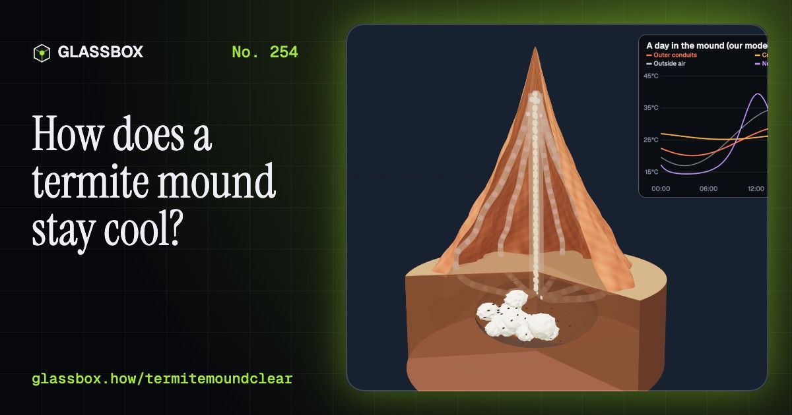
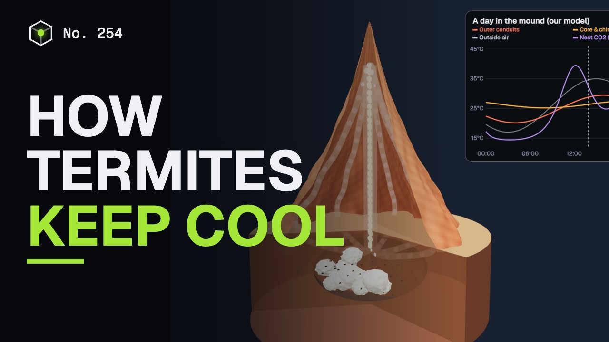
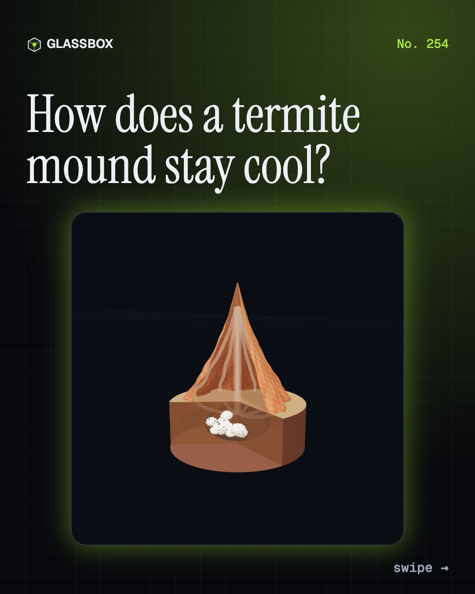
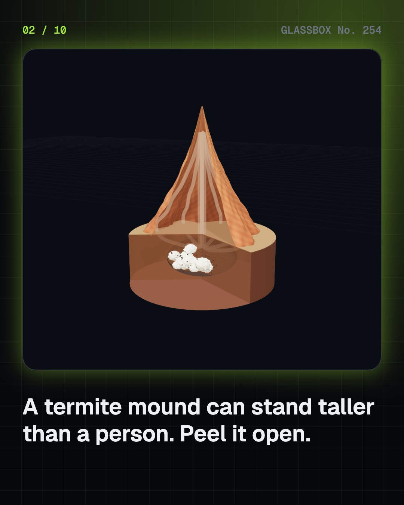
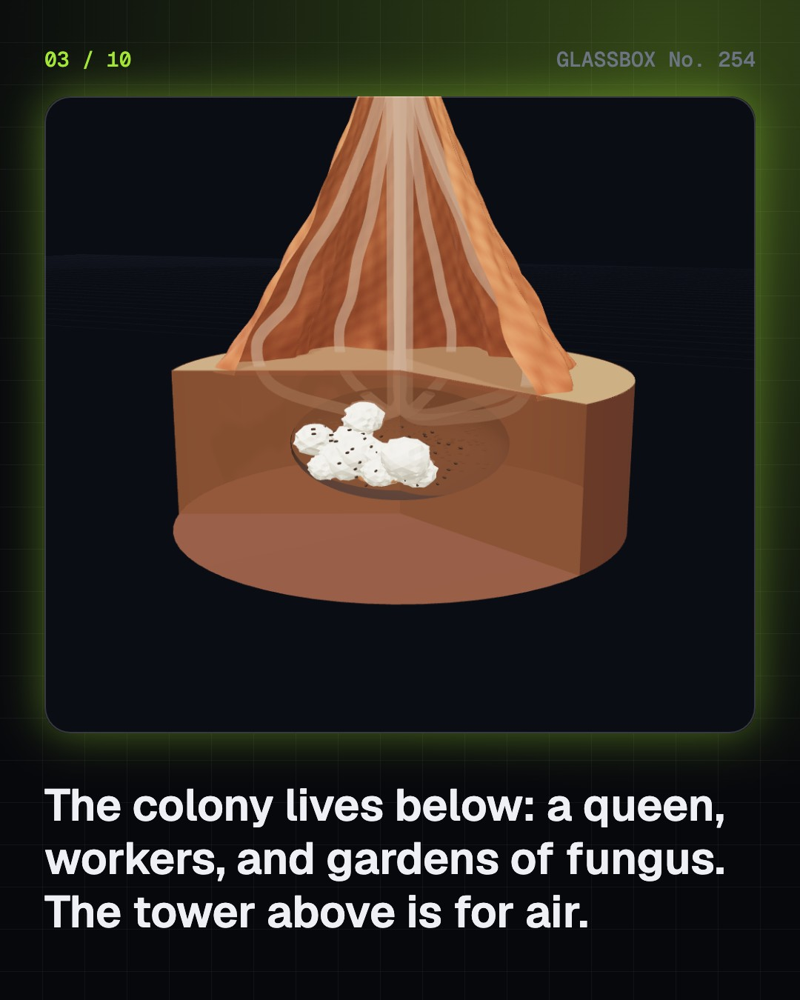
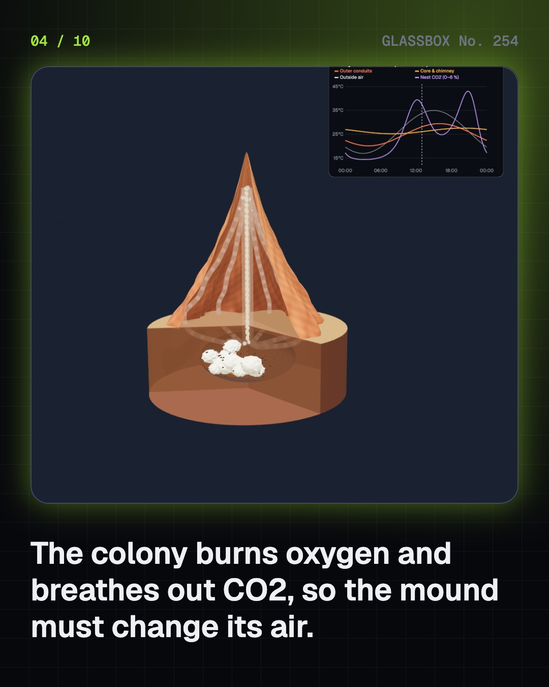

<!-- glassbox:start -->
<!-- Generated from glassbox.json by the Glassbox hub (npm run readme -- termitemoundclear). Edit glassbox.json, not this block. -->
<p align="center"><a href="https://glassbox.how/e/termitemoundclear/"></a></p>

<h1 align="center">TermiteMoundClear</h1>

<p align="center"><b>How does a termite mound stay cool?</b><br>A termite mound is a tower of soil built on top of a buried nest, and it breathes. Peel one open, watch air flip direction between day and night, feel the wind through its porous walls, and see how a building in Harare borrowed the idea.</p>

<p align="center"><a href="https://glassbox.how/termitemoundclear/"><b>▶ Play with it</b></a> &nbsp;·&nbsp; <a href="https://glassbox.how/e/termitemoundclear/">Read the 60-second explainer</a></p>

<p align="center">
  <a href="https://glassbox.how/e/termitemoundclear/"></a>
  <a href="https://glassbox.how/e/termitemoundclear/"></a>
  <a href="LICENSE"></a>
  <a href="LICENSE-CONTENT.md"></a>
  <a href="#privacy"></a>
</p>

## In 60 seconds

1. **A tower on top of a home.** Fungus-farming termites such as Macrotermes live in a nest at or below ground, with a queen, workers and gardens of Termitomyces fungus. The earth tower above is mostly for breathing. In Namibia these mounds stand about 1 to 3 metres tall, some reach 5 metres or more, and records reach about 8 metres. A big colony holds one to two million termites.
2. **The colony must breathe.** The termites and, above all, their fungus use oxygen and give off carbon dioxide, heat and water. One large nest in Kenya gave off 800 to 1,500 litres of CO2 a day. The mound's wide central chimney, its narrow conduits under the surface and its thin porous wall let stale air out and fresh air in.
3. **Breathing with the sun.** The old idea, made famous by Martin Lüscher in 1961, was a steady thermosiphon driven by colony heat. Sensors in Indian mounds told a different story in 2015: by day the thin outer flutes warm faster than the core, so air rises up the outside and sinks down the chimney; at night it reverses. CO2 built up to nearly 6 percent by day and was flushed at night. Namibian mounds showed the same twice-a-day reversal.
4. **Wind, pores and an open question.** J. Scott Turner argued that gusty wind makes air slosh back and forth in the outer conduits while gases diffuse through the porous wall, so the mound works like a lung. Other studies found the daily flows did not follow the wind. Both effects have been measured in different mounds; how much each matters is still debated.
5. **Steady, warm and humid.** The fungus grows best near 29 to 30 °C in very humid air. Large savanna nests of Macrotermes bellicosus in Côte d'Ivoire stayed near 30 °C, varying by less than 2 °C while the outside air ranged over about 35 °C. Most of the water in the nest comes from damp soil, and tunnel air has been measured at about 93 percent humidity.
6. **No plan, and a building that copied it.** No termite has a plan. Workers react to the work already done, which Pierre-Paul Grassé called stigmergy in 1959, and positive feedback turns scattered soil into pillars and walls. In Harare, Mick Pearce's Eastgate Centre (1996) uses heavy floors, night air and 48 chimneys to stay cool without conventional air conditioning; Arup reports 90 percent less energy to heat and cool, while other reports give smaller savings.

## Words worth knowing

| Term | Meaning |
|---|---|
| **Macrotermes** | A genus of large fungus-growing termites from Africa and Asia that build big mounds. |
| **Termitomyces** | A genus of fungi grown only by fungus-farming termites on combs of chewed plant matter. |
| **Surface conduits** | Narrow tunnels running just under a mound's porous outer wall, often inside its ridges. |
| **Thermosiphon** | A loop in which warm air rises, cools and sinks, driven by a steady heat source. |
| **Diurnal ventilation** | Air flow driven by the daily swing of temperature, which reverses between day and night. |
| **Tidal ventilation** | Air moving back and forth in the same passages, as gusts rise and fall. |
| **Diffusion** | Gas molecules spreading from where they are crowded to where they are scarce, with no flow needed. |
| **Thermal mass** | Heavy material, like soil or concrete, that stores heat and changes temperature slowly. |
| **Stigmergy** | Coordination through the work itself: each change to the structure prompts the next action. |
| **Night flushing** | Blowing cool night air through a building to carry away heat stored during the day. |

## A short history

**From a naturalist's 1781 letter to robots and solar-powered breathing: how people worked out what a termite mound does.**

- **1781** · A naturalist describes Africa's giant termite mounds (Henry Smeathman, Sierra Leone and London)
- **1959** · Grassé names "stigmergy" (Pierre-Paul Grassé, France)
- **1961** · The "air-conditioned termite nest" (Martin Lüscher, Scientific American)
- **1996** · The Eastgate Centre opens in Harare (Mick Pearce, Arup and Old Mutual Properties, Harare, Zimbabwe)
- **1998** · Savanna mounds versus forest mounds (Judith Korb and K. Eduard Linsenmair, Comoé National Park, Côte d'Ivoire)
- **2001** · The mound as a lung (J. Scott Turner, Namibia)
- **2014** · Robots build like termites (Justin Werfel, Kirstin Petersen and Radhika Nagpal, Harvard, Cambridge, USA)
- **2015** · Mounds breathe with the daily heat cycle (Hunter King, Samuel Ocko and L. Mahadevan, Near Bangalore, India)

The full story, with 30 moments, charts, people and 44 sources: [glassbox.how/e/termitemoundclear/history](https://glassbox.how/e/termitemoundclear/history/). The data lives in [`history.json`](history.json).

## Video and slides

Made with the Glassbox studio from this box's storyboard (`window.glassbox.director`). Free to reuse under CC BY 4.0.

<a href="https://glassbox.how/termitemoundclear/glassbox/video.mp4"></a>

<p><a href="glassbox/slide-1.jpg"></a> <a href="glassbox/slide-2.jpg"></a> <a href="glassbox/slide-3.jpg"></a> <a href="glassbox/slide-4.jpg"></a></p>

| File | What | Size |
|---|---|---|
| `glassbox/slide-1…10.jpg` | Instagram carousel | 1080×1350 |
| `glassbox/thumb.jpg` | YouTube thumbnail | 1280×720 |
| `glassbox/cover.jpg` | Share card and repo social preview | 1200×630 |

## Privacy

This box has no accounts and no ads, and it ships its own fonts and libraries. When you run it yourself it sends nothing anywhere. On glassbox.how, the site's `/bar.js` also loads Glassbox's analytics: **Google Analytics** to count visits (it asks first in the EU, UK and Switzerland, and stays off when your browser sends Global Privacy Control or Do Not Track) and **ClickTrust** to detect bots.

It remembers a few things **in your own browser only**, and never sends them anywhere:

| Browser storage key | What it holds |
|---|---|
| `termitemoundclear.v1` | Which chapters you have opened, your best quiz scores, and sound on or off. |

Exactly what each one sees is at [glassbox.how/privacy](https://glassbox.how/privacy/).

## Licences

- **Code:** [MIT](LICENSE). Use it, change it, ship it.
- **Explanations, text, images and videos** (`glassbox.json`, `glassbox/`): [CC BY 4.0](LICENSE-CONTENT.md). Credit “Glassbox, glassbox.how/e/termitemoundclear”.
- **Third-party parts** keep their own licences: [three.js](https://threejs.org) (MIT), [Geist, Instrument Serif](https://openfontlicense.org) (SIL OFL 1.1).
- The Glassbox name and logo aren't covered by either licence. See the [terms](https://glassbox.how/terms/).

Found a mistake? [Open an issue](https://github.com/bdeeps/termitemoundclear/issues). Corrections happen in public.
<!-- glassbox:end -->

## Run it

It's plain HTML, CSS and JavaScript. No build step and no dependencies. Run locally, it contacts no other website.

```bash
python3 -m http.server 8000
```

Three.js and the fonts ship in `vendor/` and `fonts/`, so it also works offline.

Then open http://localhost:8000.

## How it's built

| File | What |
|---|---|
| `index.html`, `css/app.css` | The page and its styles |
| `js/app.js`, `js/stage.js`, `js/ui.js`, `js/kit.js` | The shared Glassbox 3D engine: chapters, 3D stage, controls, quiz, video director |
| `js/chapters/*.js` | One file per chapter: the 3D model, controls, text, key terms, quiz and video scenes |
| `glassbox.json` | Title, question, explainer beats, key terms, browser storage and credits shown on glassbox.how |
| `reel` in each chapter | The storyboard the Glassbox studio records into short videos |
| `glassbox/` | The published video, slides, thumbnail and post copy |
| `fonts/`, `vendor/three/` | Self-hosted Geist and Instrument Serif (SIL OFL 1.1) and three.js (MIT) |
